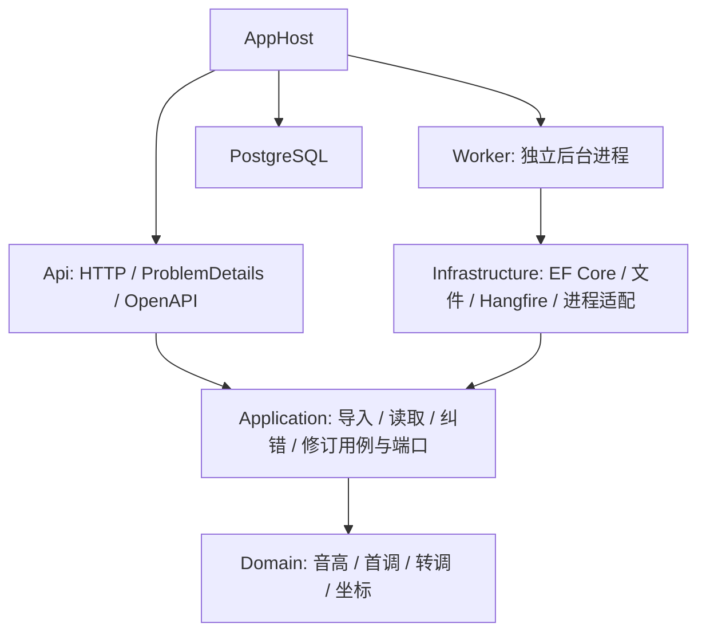

# P1 后端设计与复跑

日期：2026-10-22。本阶段是本地可运行的后端闭环，Nuxt 4 工作台放在 P2。P0 的识别正确率限制继续有效。

## 分层与依赖



- Domain 无外部依赖。保留音名拼写；D♯ 与 E♭ 的 MIDI 相同，数字与变化音仍不同。
- Application 定义存储、仓储、识别端口；`ScoreService` 编排导入、授权、幂等、纠错和不可变修订，不引用 EF Core / Hangfire。
- Infrastructure 实现端口。PostgreSQL 存任务与修订快照，EF Core 迁移建表；文件保存在工作目录下，下载使用白名单路由。Api 和 Worker 各有组合根。
- Worker 使用 Hangfire 1.8.25 + Hangfire.PostgreSql 1.21.1，后者是社区 provider。没有实现自制消息队列。当前一个 Worker 槽位串行执行识谱 / 导出，隔离每个工具尝试目录。
- ServiceDefaults 接入健康检查和 OpenTelemetry；AppHost 编排 API、Worker、PostgreSQL，数据库使用独立命名卷。原占位 Redis 已移除。

## 音高与标注契约

`Pitch(Step, Alter, Octave)`：C..B、双降至重升、八度 0..9。固定 C 以 C4 为无点的 1。首调必须给出明确主音和参考八度；大调主音为 1，自然小调采用 la-based，主音为 6。例如 G4 大调的 G4=1，A4 小调的 A4=6、C4=1。

`KeyChange.StartMeasure` 为从 1 开始的**物理小节顺序**，从本页第一个 MeasureStack 计数，含弱起小节；不是印刷小节编号，也不按反复播放展开。变更作用于该小节及后续小节。P1 对整页所有谱表使用同一组调性变更；局部声部转调留待后续。调号的 fifths 不用于猜测大小调。API 初始识别使用固定 C；P2 应落实设计中的用户选调流程。

每个识别音符有业务 `Note.Id`，同时保存 `InterId`、小节、声部、谱表、Part 与符头矩形。纠错修订保留业务 ID；新一次独立导入不承诺 ID 相同。未识别声部记为 0。

C# 生成 `NumberedLabel(Degree, Alteration, OctaveDots)`。Python 正式适配路径必须收到完整的 C# labels 映射；缺失 ID 会失败。Python 仅负责空白布局、字形测量、原 PDF 叠加，P0 单独复跑仍保留原有固定 C 路径。导出 JSON 的 `sourcePitch` 表示引擎原始音高，`pitch` 表示本修订权威音高；旧版 P0 顶层 step/alter/octave 仍为原始来源数据。

坐标为正向 CropBox 栅格左上角像素，PDF 栅格固定 216 DPI。PDF 未旋转用户坐标：`X=CropLeft+x/3`、`Y=CropTop-y/3`；不能用整数栅格宽高反推缩放。`/Rotate`、CropBox 与 MediaBox 保留在原件及导出。输出 JSON 提供 PDF 几何信息。黑色字形、PDF 5 pt（扫描图按谱线间距等比例设置），沿用 P0 扩大后的字号。

## 持久任务与修订

1. 上传校验后保存独立原件，再提交 Jobs 行。客户端持有的凭据只存 SHA-256，幂等键按凭据作用域计算。
2. Jobs / Revisions 中尚未派发的 Queued 行充当持久派发记录。Worker 每 2 秒扫描，通过 Hangfire 存储锁避免多个派发器同时调度。
3. 提交 Hangfire 与标记 BackgroundId 之间可能中断，因此按至少一次执行设计。处理器持有每个 Score 的 Hangfire 分布式锁，并检查完成状态；已发布 raw / revision 目录复用，不再次发布另一份结果。
4. 识谱每次用新目录，严格检查 HeadInter / MusicXML 的数量、音高多重集和栅格尺寸后，原子重命名为 raw。没有验证通过时不发布修订。
5. 识谱完成，Job.State=Ready，产生 Revision 1；修订导出单独有 Queued / Processing / Ready / Failed。**Job Ready 不表示 PDF 已就绪**，下载要求对应 Revision Ready。
6. 纠错携带 ExpectedRevision。PostgreSQL xmin 和唯一修订键防止覆盖并发修改，冲突返回 409。每次保存生成新快照，旧版本和导出保持不变，使用同一份原识别结果重新布局，无需识谱。
7. 用户取消将持久标志置为 true。排队任务直接 Cancelled，运行中任务先 Cancelling，处理器每 500 ms 检查，取消自己的 Python / Java 子进程树后才进入 Cancelled。Cancelling 阶段不能重试，避免过早清除取消标志。服务正常停止由 Hangfire cancellation token 通知，未被用户取消的任务退回 Queued，重启后恢复。
8. 工具默认 300 秒超时、日志最多 10,000 行且每行最多 4,000 字符。只操作该任务启动的进程树。工具确定性错误保留 Failed 与错误码，由用户显式 retry；Hangfire 对锁 / 未处理存储异常最多重试 2 次。

已验证正常停止 / 启动和 AppHost 重启。操作系统强制终止、断电、数据库中断、横向多 Worker 仍需专门验收；不能把优雅停止等同于这些情形。

## HTTP 契约

所有乐谱接口要求 `X-Score-Token`。调用方先生成至少 32 字符的高熵随机凭据，例如浏览器 `crypto.getRandomValues` 或 Python `secrets.token_urlsafe(32)`，自行保存。它是匿名资源访问能力凭据；丢失后目前没有恢复入口。GET 不接受 URL query 中的 token。没有账户 / Cookie 身份验证，不启用 CORS；P2 可由同源 Nuxt BFF 转发。当前凭据没有 TTL，过期策略放在 P5，不宣称短期票据已经实现。

| 方法 / 路由 | 请求与结果 |
| --- | --- |
| POST `/api/scores` | multipart 字段 `file`；另带 `Idempotency-Key` 8..100 字符；202 + Location 指向新任务，重复相同字节返回同一 ID，不同字节返回 409 |
| GET `/api/scores/{id}` | JobView，含状态、Attempts、CurrentRevision、错误码与时间 |
| GET `/api/scores/{id}/revisions/{version}` | 指定修订；修订不存在返回 404 |
| POST `/api/scores/{id}/revisions` | ExpectedRevision、Corrections、Numbering；202 + Location 指向新修订，乐谱未 Ready / 版本冲突为 409 |
| GET `/api/scores/{id}/revisions/{version}/layout` | 单页修订的布局 / 坐标 / 待放置标记，含业务 NoteId；多页父任务返回 400 select-page |
| GET `/api/scores/{id}/revisions/{version}/annotated-pdf` | 下载指定 Ready 修订，未完成为 409；支持 Range |
| GET `/api/scores/{id}/revisions/{version}/annotations` | 下载原始布局 JSON |
| GET `/api/scores/{id}/revisions/{version}/metrics` | 下载几何 / 导出检查结果，不是全页语义准确率 |
| POST `/api/scores/{id}/exports` | 为多页文档创建整份导出；202 + Location 指向导出快照 |
| GET `/api/scores/{id}/exports/{version}` | 读取整份导出状态；不存在返回 404 |
| POST `/api/scores/{id}/cancellations` | 取消 Queued / Processing 识别；202 + Location 指向父任务；已终止任务返回 409 |
| POST `/api/scores/{id}/retries` | 重试 Failed / Cancelled 识别；传单页 id 时也可重新识别 Ready 页并生成新修订；202 + Location 指向父任务，原错误清空 |
| GET `/api/scores/{id}/source` | 下载原上传文件，支持 Range |
| GET `/api/scores/{id}/musicxml` | 下载单页原始 MusicXML；多页父任务返回 409 |
| GET `/health`、`/alive` | API 检查数据库；Worker 另检查识谱运行时就绪状态；`/alive` 仅检查进程存活 |
| GET `/openapi/v1.json` | Development 环境的 OpenAPI；不公开 Hangfire Dashboard |

纠错示例：

```json
{
  "expectedRevision": 1,
  "corrections": [
    { "noteId": "用 GET 结果中的业务 UUID", "pitch": { "step": "F", "alter": 1, "octave": 4 } }
  ],
  "numbering": {
    "mode": "MovableDo",
    "keys": [
      { "startMeasure": 1, "tonic": { "step": "G", "alter": 0, "octave": 4 }, "scale": "Major" },
      { "startMeasure": 5, "tonic": { "step": "D", "alter": 0, "octave": 4 }, "scale": "Major" }
    ]
  }
}
```

错误使用 ProblemDetails。缺少 / 太短凭据 401，错误但格式合法的凭据 404，不暴露文件归属。输入不支持 415、签名或规则错误 400、过大 413。后台错误通过状态中的 ErrorCode 查询，详细工具异常写在受服务器目录权限控制的日志内，不在 HTTP 响应中返回绝对目录。

## 本地启动与验证

本次运行环境：Windows，.NET SDK 10.0.402，Docker，Aspire SDK 13.6.2，Audiveris 5.11.0。Python 依赖与工具固定流程见 [P0 复跑](../tests/acceptance/README.md)。先完成一次 P0 工具准备，再使用下面的运行时准备；Worker 不会在处理用户文件时下载 JDK / Audiveris。

```powershell
# 创建项目独立环境、安装固定依赖并检查工具。AppHost 默认选择 .tools/poc-python。
./scripts/setup/setup.ps1
# 首次准备 Poppler 时可显式指定便携分发包的 Library 目录；完整 bin / DLL / share 会复制到项目 .tools/poppler。
# ./scripts/setup/setup.ps1 -PopplerDirectory C:/tools/poppler/Library
# 可选实验性光照预处理：./scripts/setup/setup.ps1 -WithOpenCV
# 需要其他解释器时，可显式配置 Recognition:Python 或 MUSICRECOGNITION_PYTHON。
# Worker 默认使用 .tools/poppler/bin/pdftoppm.exe；外部安装可用 Recognition__Pdftoppm 覆盖为绝对路径。
# Worker 启动先检查 Python 包、Java / 适配器、字体，并真实渲染小 PDF；失败时不启动任务消费。
dotnet tool restore
dotnet build MusicRecognition.slnx
dotnet test tests/MusicRecognition.Domain.Tests
aspire start --apphost MusicRecognition.AppHost/MusicRecognition.AppHost.csproj --non-interactive
aspire wait worker --apphost MusicRecognition.AppHost/MusicRecognition.AppHost.csproj --non-interactive
aspire describe --apphost MusicRecognition.AppHost/MusicRecognition.AppHost.csproj --non-interactive
```

从 describe 获取动态 API URL。API 启动应用 EF migrations，Worker 等待 API 就绪后启动。`output/backend/{jobId:N}/` 与数据库卷需要一起保留。重新生成项目之前停止本 AppHost，避免 Windows 文件锁；不要停止其他项目的 AppHost。

```powershell
# 用不同证据文件创建新任务，不同测试目录内保存各版下载件。
& $env:MUSICRECOGNITION_PYTHON tests/e2e/test-p1.py flow --url $apiUrl --file output/poc-pdf/input/Minuet-xpose-a4.pdf --evidence output/p1/my-run/flow.json
& $env:MUSICRECOGNITION_PYTHON tests/e2e/test-p1.py negative --url $apiUrl --evidence output/p1/my-run/flow.json
& $env:MUSICRECOGNITION_PYTHON tests/e2e/test-p1.py keys --url $apiUrl --evidence output/p1/my-run/flow.json
# 真实工具 10 秒超时测试；不会连接数据库。
$env:MUSICRECOGNITION_TEST_ROOT = (Get-Location).Path
dotnet test tests/MusicRecognition.Infrastructure.Tests
# 导出独立栅格检查；路径中的 ID 去掉连字符。
& $env:MUSICRECOGNITION_PYTHON tests/acceptance/verify-p1-export.py --job output/backend/JOB_ID_N --version 2
```

恢复复跑：`aspire resource worker stop` → submit → `aspire resource api restart` → `aspire wait api` → check-queued → `aspire resource worker start` → `aspire wait worker` → resume。每条 Aspire 命令都带当前 AppHost 路径。运行中恢复则 submit → wait-processing → worker stop/start → resume。测试凭据仅保存在忽略的 output 证据文件中，不要发布这些文件。

## 边界与后续

P1 只接受 20 MiB 内的一页未加密 PDF / JPG / PNG；PDF 渲染最多 2,000 万像素，正交 `/Rotate`、默认 UserUnit、包含于 MediaBox 的 CropBox。不是任意扫描角度矫正。拒绝多页、非标准 UserUnit 与不支持的完整 ottava。MXL 是引擎内部交换结果，上传 MusicXML / MXL 与重排模式尚未实现。

本地文件适配器与 Java / Windows 字体路径尚未容器化。还未实现手动拖动标注、导出任务单独取消 / 重试、存储清理、账户、能力凭据 TTL、限流、备份恢复或容量验收。复杂谱的音高一致性失败不会通过纠错接口绕过。P2 对待放置音符提供明确的人工操作入口，不能隐藏未完成标注。

采用的官方 / 维护者资料：[ASP.NET Core Minimal APIs](https://learn.microsoft.com/aspnet/core/fundamentals/minimal-apis/overview?view=aspnetcore-10.0)、[Npgsql EF Core](https://www.npgsql.org/efcore/)、[Hangfire ASP.NET Core](https://docs.hangfire.io/en/latest/getting-started/aspnet-core-applications.html)、[PostgreSQL provider](https://github.com/hangfire-postgres/Hangfire.PostgreSql)、[Aspire PostgreSQL](https://aspire.dev/integrations/databases/postgres/)。实际编译与恢复证据见 [P1 验证报告](p1-report.md)。
